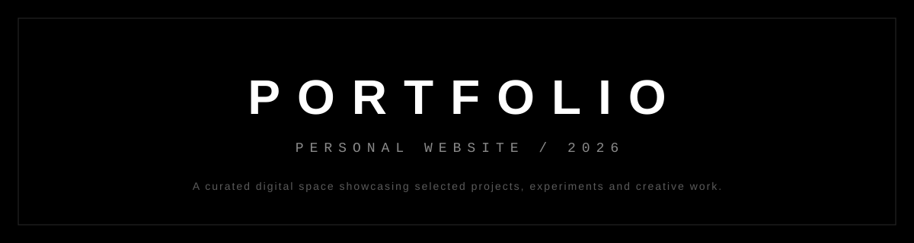

<div align="center">

<br>



<br>

<a href="YOUR_WEBSITE_URL">
  
</a>
&nbsp;
<a href="#-about">
  
</a>

<br><br>

</div>

---

<div align="center">

### THE EXPERIENCE

*A minimal approach to digital design.*

</div>

---

## 01 — About

<a id="-about"></a>

A personal portfolio website built to bring **projects**, **creativity** and **technology** together in one place.

Designed with attention to detail, clean layouts and a strong focus on user experience.

---

## 02 — Highlights

| | |
|---|---|
| 🎨 **Minimal & modern** | Clean interface with a distraction-free look |
| 🧱 **Structured layouts** | Carefully organised sections and spacing |
| 📱 **Fully responsive** | Works across phones, tablets and desktops |
| ✨ **Interactive elements** | Subtle animations and hover effects |
| 🗂️ **Project showcase** | Dedicated section for selected work |
| ✉️ **Contact** | Personal introduction and a way to get in touch |

---

## 03 — Technology

<div align="center">


</div>

---

## 04 — Repository

```text
portfolio/
├── index.html      # Page structure
├── style.css       # Styling and responsive layout
├── script.js       # Interactivity
├── assets/         # Images, icons and fonts
└── README.md       # Project documentation
```

---

## 05 — Getting Started

```bash
# Clone the repository
git clone https://github.com/YOUR_USERNAME/portfolio.git

# Move into the project folder
cd portfolio

# Open index.html in your browser, or serve it locally
npx serve .
```

---

<div align="center">

**EXPLORE. CREATE. BUILD.**

<sub>Designed and developed with intention.</sub>

<br>

<sub>© 2026 · PORTFOLIO</sub>

</div>
